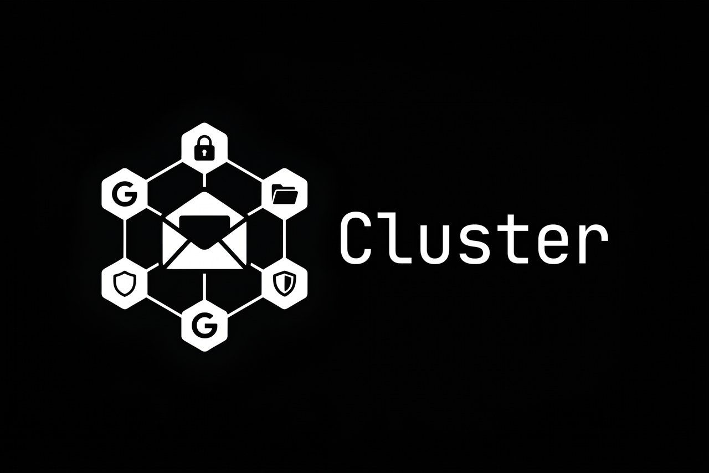

<p align="center"></p>

<p align="center">
  <a href="https://github.com/Samuelabhinav37/cluster/actions/workflows/ci.yml"></a>
</p>

<p align="center"><b>A Chrome extension that sorts, cleans up and protects your Gmail inbox. It runs in your browser and reads headers, not your emails.</b></p>

## What Cluster does

Your inbox ends up holding only what you haven't dealt with yet. Everything else goes to its place:

- **Mail from people** goes to 👤 Personal.
- **Machine mail** (codes, receipts, shipping, newsletters and more) goes to its own label.
- **Senders Cluster can't place, and strangers**, wait in ✋ Screener until you decide.
- **Scams** go to Spam.

It also clears out old mail, unsubscribes you properly and warns you about fake senders. Every change can be undone.

Cluster works with Gmail. Outlook is supported for most features (see [Limits](#limits)).

## How sorting works

Cluster reads each email's headers: who sent it, the subject, the date, Gmail's tab, and the sending and sign-in records a mail server adds. It never reads the message itself for sorting.

Each email goes through four checks, in this order:

1. **Is it a scam?** Fake brand names, lookalike addresses (`paypa1.com`), failed sign-in checks, known-bad domains and the same message sent from many throwaway addresses. Clear scams go to Spam. Suspicious ones wait in Screener.
2. **Is it from someone you know?** You've written to them, they're replying in your thread, one of your contacts is copied, or it's a note you sent yourself. It goes to 👤 Personal.
3. **Does it fit a label?** The subject and the sender decide. "Your code is 4821" goes to One-time codes. A bank statement goes to Finance.
4. **Anything left** goes to ✋ Screener, including first-time strangers on Gmail, Yahoo and other free mail. One tap lets a sender in for good. To let strangers through instead, turn off **Hold people too** under Security → New senders.

When you move an email to a different label in Gmail, Cluster learns from it. One correction covers all future mail from that sender.

### The labels

| Label | What goes there |
|---|---|
| 👤 Personal | People you know, and replies in your threads |
| ✋ Screener | New senders and anything Cluster isn't sure about |
| 🔑 One-time codes | Sign-in codes and magic links |
| 🔐 Accounts | Sign-in alerts, password changes, "verify your email" |
| 🧾 Receipts | Receipts and invoices |
| 📦 Orders & shipping | Order confirmations and delivery updates |
| 💳 Finance | Statements, balances, payments |
| 📰 Newsletters | Newsletters and mailing lists |
| 🏷 Promotions | Sales and offers |
| 🛍 Shopping, 🧳 Travel, 💼 Work, 🎓 Education, 📋 Jobs, 💬 Social | Mail from those kinds of companies |

Gmail filters keep labelling new mail even when your browser is closed.

## The app

Click the Cluster icon in Chrome's toolbar to open it.

| Screen | What it's for |
|---|---|
| **Overview** | What came in, what Cluster did, and anything that needs you |
| **Sort inbox** | Sort new mail, or everything you've ever received |
| **Cleanup** | Mail you never open, old codes and delivered orders, all moved to Trash in one go |
| **Stop mail** | Unsubscribe properly, then check that the mail really stopped |
| **Labels** | Choose how long each kind of mail stays in your inbox |
| **Security** | Fake senders, scams Cluster held back, and new senders waiting in Screener |
| **Details** | The actual emails behind any number you tap |
| **Settings and Activity** | Your choices, what Cluster learned, and every action with Undo |

**Kai** is Cluster's guide. It sets you up on the first run and answers short typed requests: press `/`.

## Private by design

- **Headers only.** Cluster reads who sent an email, the subject and the date, not the message. The one exception: for mail already flagged as a likely scam, it checks where the links go and keeps only two counts.
- **No Cluster server for your mail.** Everything runs in your browser. Your mail index stays on your computer.
- **Nothing deleted for good.** Cleanup moves mail to Trash. Starred mail is never touched.
- **You can see and erase everything.** Settings → Privacy shows what's stored, exports it, or erases it all.

[SECURITY.md](SECURITY.md) and the [privacy notes](docs/privacy.md) list every permission and everything that leaves your browser.

## Install

Cluster isn't in the Chrome Web Store yet. To run it from source:

1. Install [Node.js](https://nodejs.org/) 20 or later.
2. Build it:
   ```sh
   git clone https://github.com/Samuelabhinav37/cluster.git
   cd cluster
   npm ci
   npm run build
   ```
3. Open `chrome://extensions` and turn on **Developer mode** (top right).
4. Click **Load unpacked** and choose the `dist` folder.
5. Click the Cluster icon and sign in with Google.

Google only lets accounts on the project's test list sign in while Cluster is in testing. To use your own Google sign-in, follow the steps below.

<details>
<summary><strong>Use your own Google sign-in</strong></summary>

1. In [Google Cloud Console](https://console.cloud.google.com/), create a project.
2. Under **OAuth consent screen**, choose **External** and leave it in **Testing**. Add yourself as a test user, and add the scopes `gmail.modify` and `gmail.settings.basic`.
3. Load Cluster once (steps above) and copy the extension ID from `chrome://extensions`.
4. Under **Credentials**, create an **OAuth client ID** of type **Web application** with the redirect URI `https://<extension-id>.chromiumapp.org/`.
5. Put the client ID in `src/lib/gmailWebAuth.ts` and `auth-worker/wrangler.toml`.
6. Deploy the small sign-in helper with your client secret:
   ```sh
   npx wrangler secret put GOOGLE_CLIENT_SECRET --config auth-worker/wrangler.toml
   npx wrangler deploy --config auth-worker/wrangler.toml
   ```
7. Run `npm run build` again and reload Cluster.

The helper only swaps Google's sign-in code for a token. It never sees mail and stores nothing.

</details>

## How it's tested

Sorting is tested against made-up mailboxes run through Cluster's real code:

| Test mailbox | Emails | Sorted acceptably | People sent to Spam | Scams shown as mail |
|---|---|---|---|---|
| Real brands (the set the rules were tuned on) | 2,000 | 100% | 0 | 0 |
| Three held-out sets, with brands no rule lists | 2,000 each | 99.95% to 100% | 0 | 0 |
| Held-out set D | 3,000 | 100% | 0 | 0 |

Each held-out set was written before the changes it tests. Other tests shuffle the mail, respell addresses and strip headers, and check that nothing moves for the wrong reason. Sorting time grows in a straight line: about 0.25 seconds for 3,000 emails and 2.6 seconds for 48,000.

You can also test against your own mail without it leaving your computer: run `clusterExportReplay()` in the dashboard's console and save the file to `replay/`, which git ignores.

## Limits

- **Outlook** supports scanning, sorting, cleanup, unsubscribe, rules, mute and the Screener. Snooze and the deep link check are Gmail only.
- **One account per provider.**
- **A scam that only its message text gives away**, sent once from a new address, can reach Screener instead of Spam, because Cluster doesn't read message text. It still never reaches your inbox.
- **"Quiet" after unsubscribing** means no newer mail showed up in the scan. It doesn't prove the sender stopped for good.

## For developers

```sh
npm run dev         # rebuild on change, then load dist/ in Chrome
npm test            # all tests, including the mailbox tests
npm run typecheck   # types
npm run lint        # ESLint
npm run build       # dist/
```

| Folder | What's in it |
|---|---|
| `src/dashboard/` | The app window: one file per screen |
| `src/background.ts` | Timed jobs that run while Chrome is open: moving mail, rules, scam checks |
| `src/lib/` | The logic: reading senders, sorting, scam signals, rules. Most of it is plain functions with their own tests |
| `src/test/` | The made-up mailboxes and the harness that sorts them |
| `public/data/`, `src/lib/data/` | Lists that ship with Cluster: brand domains, known-bad and spam domains, public suffixes |
| `auth-worker/` | The sign-in helper (a Cloudflare Worker) |
| `scripts/` | Rebuilding the bundled lists (`npm run refresh:brands`, `refresh:blocklist`, `refresh:spam`) |

Good places to start reading:

- [How Cluster works](docs/how-cluster-works.md): a walk through the whole app, in the order you meet it
- [Technical notes](docs/technical-notes.md): detection signals, the rules engine and background jobs in depth
- [Testing](docs/testing.md), [Dev setup](docs/dev-setup.md) and [Setup](SETUP.md)
- [Security](SECURITY.md) and [OAuth scopes](docs/oauth-scope-justification.md)
- Research behind the sorting: [sorting mistakes](research/2026-11-15-sorting-mistakes-research.md) and [how other mail apps do it](research/2026-11-15-competitor-sorting.md)
